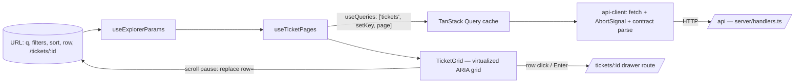

# Ticket Explorer

A searchable, filterable, sortable explorer over **10,000 support tickets** that stays fast and never shows the
wrong results — under slow networks, failed requests, fast typing, keyboard-only use and screen readers.
(Frontend Developer assignment — Problem Statement 1.)

- **Live app:** https://data-explorer-puce.vercel.app
- **Try failure modes live:** use the **Simulated network** menu in the header (Realistic · Fast · Always slow ·
  Always fail), or DevTools network throttling / offline.

## Security

Static SPA plus read-only mock API with no auth or user data (synthetic tickets on `example.com`). Strict
Content-Security-Policy (`'self'` only — no inline scripts or eval in the build), `nosniff`, `Referrer-Policy`,
`Permissions-Policy`, COOP, HSTS (Vercel); API input validated by the shared Zod schema with length/size caps;
`dangerouslySetInnerHTML` is lint-banned; `pnpm audit` in CI and Dependabot for updates.

## Run locally

Prerequisites: Node ≥ 20, pnpm 9.

```sh
pnpm install
pnpm dev                 # http://localhost:5173 — app + mock API (/api), same handlers as production
pnpm verify              # typecheck, lint, unit/integration tests, build, bundle-size budget
pnpm exec playwright install chromium webkit
pnpm e2e                 # Playwright in Chromium + WebKit, incl. axe accessibility scans
```

## What it does

| Requirement              | How                                                                                                                                                                                                                                                          |
| ------------------------ | ------------------------------------------------------------------------------------------------------------------------------------------------------------------------------------------------------------------------------------------------------------ |
| Never show stale results | Every page of results is cached under `['tickets', <canonical query>, page]`. A late response can only land under the query that asked for it, so it can't render under a newer one. Superseded requests are also aborted, and search is debounced (300 ms). |
| State in the URL         | `q`, filters, sort, scroll position (`row=`) and the open ticket (`/tickets/:id`) all live in the URL. Refresh, Back/Forward and shared links restore the exact view, including scroll.                                                                      |
| Fast with large lists    | Virtualized grid: ~20–40 rows in the DOM out of 10,000. Only visible 50-row pages are fetched (plus a prefetch margin). Rows are memoized.                                                                                                                   |
| Honest states            | Distinct loading, empty, error (with Retry) and partial-failure states (some pages failed → those rows are marked and "Retry failed rows" refetches only them). A failed query removes the old rows rather than leaving them looking current.                |
| Accessible               | ARIA grid with true `aria-rowcount`/`aria-rowindex`, one tab stop with arrow/Page/Home/End navigation, sortable headers with `aria-sort`, native form controls, visible focus, skip link, live regions announcing counts and errors.                         |
| Detail view              | `/tickets/:id` opens a modal drawer over the still-mounted list; deep-linkable; closing keeps filters and scroll and returns focus to the row.                                                                                                               |

## Mock API

Production uses Vercel Functions (`api/`); local dev and preview use Vite middleware; tests use MSW. All three
call the same handlers in `server/` ([ADR-0002](docs/adr/0002-one-query-engine-three-adapters.md)).

| Endpoint               | Description                                                                                                                                                                                                                                                                                                                            |
| ---------------------- | -------------------------------------------------------------------------------------------------------------------------------------------------------------------------------------------------------------------------------------------------------------------------------------------------------------------------------------- |
| `GET /api/tickets`     | `q`, `status`, `priority`, `channel`, `assignee` (comma lists; `unassigned` matches no assignee), `from`/`to` (inclusive `YYYY-MM-DD`, UTC), `sort` (`createdAt`, `-createdAt`, `priority`, …), `page` (0-based), `pageSize` (10–100). Returns `{ items, total, page, pageSize, requestId }`. Invalid params → 400 with `fieldErrors`. |
| `GET /api/tickets/:id` | One ticket (`TCK-000123`), or 404.                                                                                                                                                                                                                                                                                                     |

Every request waits a random **200 ms–3 s** and fails with a **503 about 1 time in 10**. For demos and
deterministic tests, send `x-chaos: off | fail | slow` (the header menu does this) or set `CHAOS=off` server-wide.

```sh
curl -H 'x-chaos: off' 'http://localhost:5173/api/tickets?q=refund&status=open,pending&sort=-priority&pageSize=10'
```

## Architecture and state management



- **View state lives only in the URL** ([ADR-0003](docs/adr/0003-server-state-in-query-view-state-in-url.md)).
  Parsing is lenient (bad links degrade to defaults); serialization is canonical (equal views → identical URLs →
  identical cache keys). Discrete choices push history; typing and scrolling replace it.
- **Server state lives only in TanStack Query.** No global store. One automatic retry, then a visible error
  ([ADR-0005](docs/adr/0005-retry-policy.md)).
- **One contract, both sides.** `src/shared/contract.ts` (zod/mini) validates requests on the server and responses
  on the client.
- **Sparse-page virtualization** ([ADR-0004](docs/adr/0004-sparse-page-virtual-grid.md)): the grid knows the total
  and renders skeletons for pages not yet loaded; each page has its own loading/error state.
- **Detail drawer = nested route + native `<dialog>`** ([ADR-0006](docs/adr/0006-drawer-nested-route-native-dialog.md)).

All decisions: [docs/adr](docs/adr/README.md). Requirements and acceptance criteria:
[docs/requirements.md](docs/requirements.md). Test strategy: [docs/testing.md](docs/testing.md).

## Tradeoffs

- **No "previous results" while a new search loads.** Showing old rows dimmed is a common UX, but with per-page
  queries it can mix pages from two result sets. A short skeleton is the honest choice.
- **Row-level focus instead of cell-level** in the grid: fewer keystrokes for a read-only list; a deliberate
  simplification of the APG grid pattern ([ADR-0007](docs/adr/0007-aria-grid-row-focus.md)).
- **Typing replaces history** rather than pushing it, so Back skips intermediate keystrokes and returns to the
  previous filter/sort choice.
- **Bundle budget 140 kB gzipped** (134 kB actual), after switching to zod/mini; React Router was kept rather than
  hand-rolling history handling ([ADR-0008](docs/adr/0008-bundle-budget-and-zod-mini.md)).
- **In-memory mock data** (seeded, deterministic) instead of a database: the assignment is about frontend behaviour;
  the API still does real server-side search, filtering, sorting and pagination.
- **Dates are UTC** everywhere (display and filters), so a ticket never appears outside its filtered range.

## Sources and references

- TanStack Query — [Query cancellation](https://tanstack.com/query/latest/docs/framework/react/guides/query-cancellation), [useQueries](https://tanstack.com/query/latest/docs/framework/react/reference/useQueries), [retries](https://tanstack.com/query/latest/docs/framework/react/guides/query-retries)
- TanStack Virtual — [Virtualizer API](https://tanstack.com/virtual/latest/docs/api/virtualizer) (and its source, to understand `initialOffset` and scroll clamping)
- React Router — [useSearchParams / navigate options incl. `flushSync`](https://reactrouter.com/)
- WAI-ARIA Authoring Practices — [Grid pattern](https://www.w3.org/WAI/ARIA/apg/patterns/grid/), [Dialog (modal) pattern](https://www.w3.org/WAI/ARIA/apg/patterns/dialog-modal/)
- MDN — [`<dialog>` and `showModal()`](https://developer.mozilla.org/en-US/docs/Web/HTML/Element/dialog), [`aria-rowcount`](https://developer.mozilla.org/en-US/docs/Web/Accessibility/ARIA/Attributes/aria-rowcount), [ARIA live regions](https://developer.mozilla.org/en-US/docs/Web/Accessibility/ARIA/ARIA_Live_Regions)
- Zod — [zod/mini](https://zod.dev/packages/mini); MSW — [Node integration](https://mswjs.io/docs/integrations/node)
- Vercel — [Functions with Web-standard handlers](https://vercel.com/docs/functions), [rewrites](https://vercel.com/docs/project-configuration#rewrites)
- axe-core / @axe-core/playwright for automated accessibility checks
- Free-tier services: Vercel (hosting + functions), GitHub (repo)

## AI usage

Built with **Claude Code** (Anthropic) as a pair programmer: planning, implementation, tests and reviews, with every
change verified by running the gates. See [docs/ai-usage.md](docs/ai-usage.md) for how the AI was directed, what was
corrected, and the shared conversation.
